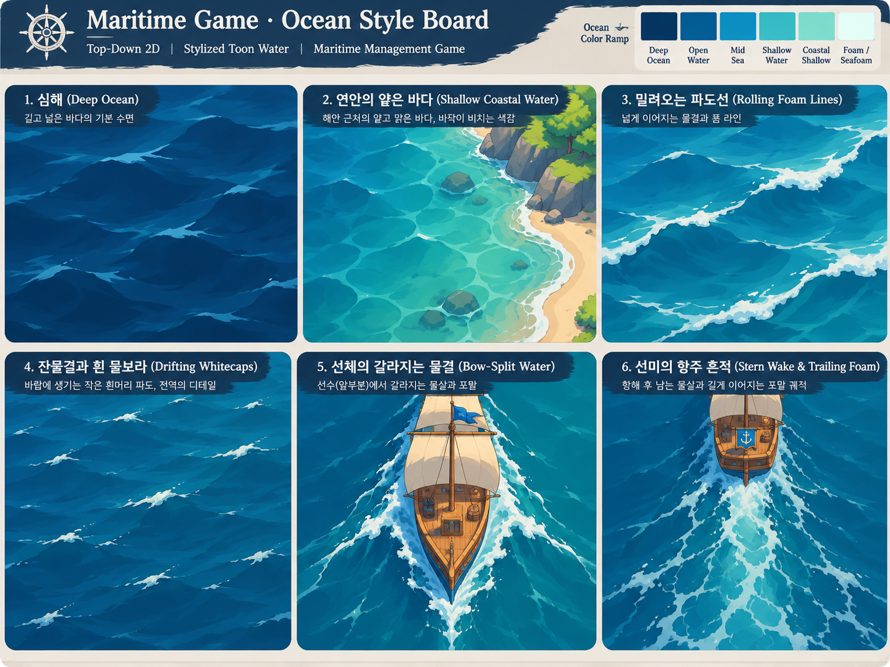
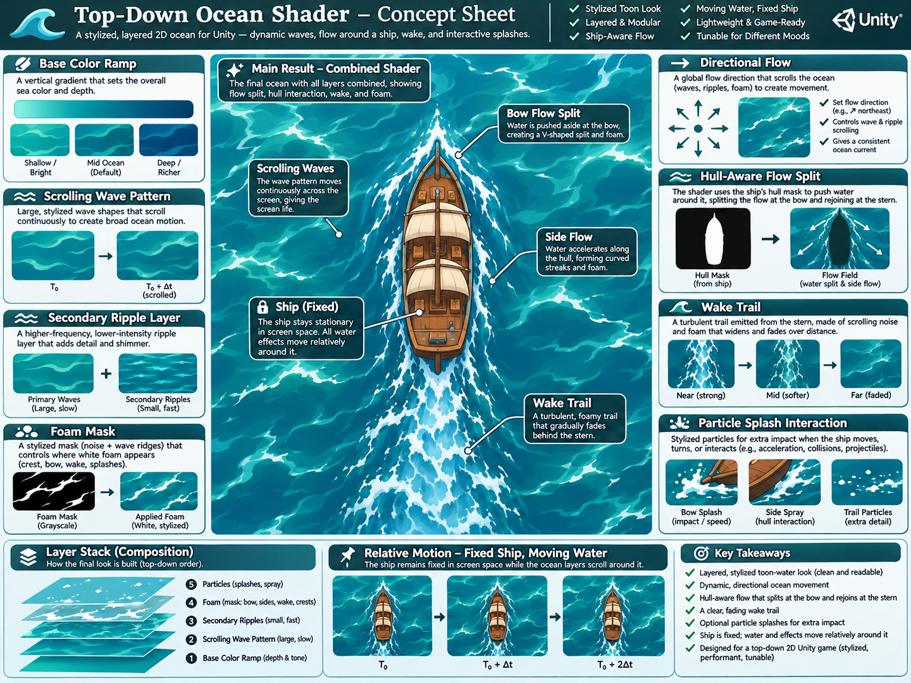
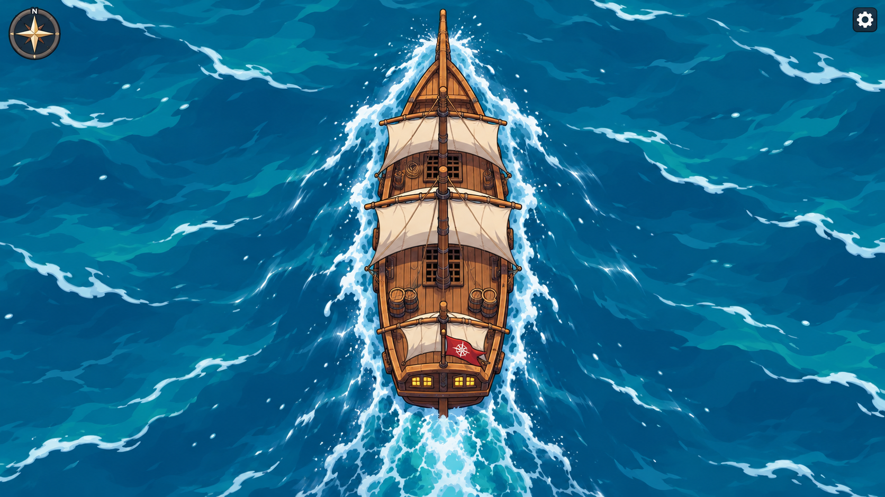

# Great Voyage — P5 Water 참조 이미지·자료 및 사용 규칙

- 문서 종류: **참조 이미지 및 근거 자료 모음**
- 연관 문서: `P5_OceanSystem_Design.md`, `P5_Water_VisualDesign.md`, `P5_Water_ImplementationRoadmap.md`
- 참조 키워드: **`unity 2d stylized toon water`** / `top down stylized ocean foam` / `Unity 2D water Shader Graph`
- 상태: **스타일 방향 참조로 수용, 개별 픽셀/색상/배치 및 게임 적용은 미승인인 후보 이미지 및 설명**. 아래 이미지는 화풍·구조를 논의하기 위한 컨셉 생성물이며, 최종 게임용 Texture/Shader/아트 에셋 승인본이 아니다.

## 1. 패키지에 포함된 참조 이미지 3종

### R01 — Ocean Style Board

- **파일:** `References/OceanStyleBoard.png`
- **유형:** 대화 요청에 따라 생성된 **컨셉 아트 스타일 보드**
- **읽을 부분:** 심해/연안 색상 차이, 큰 유기적 파도 띠, 불규칙한 흰 포말 선, 잔물결·whitecaps, 선수 분기, 선미 항적.
- **확정하지 않는 부분:** 실제 게임의 정식 팔레트·섬/선박 실루엣·UI 디자인·물결 속도.

### R02 — Ocean Shader Concept

- **파일:** `References/OceanShaderConcept.png`
- **유형:** 레이어 구성과 표현 원리를 시각화한 **개념도**
- **읽을 부분:** Base color / Large waves / Ripples / Foam / Relative Flow / Hull interaction / Wake의 분리, **고정 선박 + 상대 이동 바다**, 선체 마스크 기반 물결 분기.
- **확정하지 않는 부분:** 셰이더의 실제 내부 노드 구성, 검증된 Unity 성능, 원본 게임의 선박/Canvas/색상 사양. 그림 안의 도식·텍스트는 코드 구현 증거가 아니다.

### R03 — Ocean Gameplay Mockup

- **파일:** `References/OceanGameplayMockup.png`
- **유형:** 탑다운 해상 표현을 가정한 **시각적 목업**
- **읽을 부분:** 선수에서 좌우로 갈라지는 물살, 선측 포말, 선미 후류, 짙은 바다 색면과 밝은 포말의 대비.
- **확정하지 않는 부분:** 선박 Sprite/돛/갑판 구성, 실제 UI, 정확한 파티클 밀도·최종 화풍, 실시간 동작의 품질.

## 2. 외부 참고 자료 (학습 및 구현 방식 참조)

### E01 — Unity 공식 2D Shader Basics: Creating Water with Shader Graph

- 링크: https://www.youtube.com/watch?v=eD7LmXShYcs
- **역할:** Unity 2D 환경에서 스크롤 UV·Noise·2D 조명으로 물 표현을 구성하는 기본 원리 참조.
- **제한:** 과거 Unity 버전 튜토리얼이며, Great Voyage의 최신 URP 버전·목표 화풍·선체 유동을 자동 충족한다는 뜻이 아니다.

### E02 — Gabriel Aguiar: Unity 2D Water Shader Tutorial

- 링크: https://www.youtube.com/watch?v=-jA72OSTfwk
- **역할:** 2D URP/Shader Graph 수면·해안 효과의 표현 방법 참조.
- **제한:** 그대로 따라 만들라는 요청이 아니며, 반사·굴절 등을 주요 스타일로 채택할 수 있는 허가가 아니다.

### E03 — Stylized Water 2 (Unity Asset Store)

- 링크: https://assetstore.unity.com/packages/vfx/shaders/stylized-water-2-for-unity-2021-2023-170386
- **역할:** 다양한 Toon 수면의 파도/포말 레이어 디자인을 비교하는 **시각적 참조**.
- **중요:** **3D 렌더링용이며 2D Renderer·Tilemap과 호환되지 않는다고 명시**되어 있다. Great Voyage에 직접 사용하거나 구매하라는 권고가 아니다.

### E04 — Stylized Water Shader Pack (Unity Asset Store)

- 링크: https://assetstore.unity.com/packages/vfx/shaders/stylized-water-shader-pack-urp-built-in-390566
- **역할:** Toon 물의 색면, 포말, 파문 등 시각 레이어 비교.
- **제한:** 주로 3D 표면용 소개다. 실제 Great Voyage의 **URP 2D Renderer/Tilemap 호환성은 별도 확인 필요**. 참조 화면만 활용한다.

## 3. AI에 참조 이미지를 전달할 때의 해석 계약

- **R01은 형태·색면·포말의 아트스타일 참고**, R02는 **시스템 레이어와 데이터 흐름 참고**, R03은 **선체 주변 상호작용의 시각적 목표 참고**로 사용한다.
- 이미지의 선박 구조, 해안·장식물, 임의 HUD는 **원래 기획에 없는 신규 자산/구조를 추가할 근거가 아니다.**
- 각 참조 항목을 `P5_Water_VisualDesign.md`의 어떤 디자인 규칙에 적용했는지 설명한다.
- 이미지의 글씨나 컨셉 라벨을 정확한 기술 스펙으로 오해하지 않는다.
- 결과가 유사하다는 추측만으로 승인 처리하지 않는다. **실제 Unity Game View 비교와 사용자 직접 수용**이 필요하다.
- 참조 이미지를 **Shader Texture로 임의 사용·재가공하거나 제품에 포함하지 않는다.** 실제 게임용 아트로 전환하려면 별도 명시 승인 및 에셋 검증이 필요하다.

## 4. 참조 이미지 대조 체크리스트

| 비교 항목 | R01 | R02 | R03 | 실제 Game View 확인 |
|---|:---:|:---:|:---:|---|
| 여러 단계로 구분된 해수 색면 | ✓ | ✓ | ✓ | 필요 |
| 방향성 있는 굴곡진 큰 파도 형태 | ✓ | ✓ | ✓ | 필요 |
| 작은 잔물결·흰 물결 마루 | ✓ | ✓ | ✓ | 필요 |
| 바다의 상대 흐름(시간 변화) | — | 구조 개념 | 정지 장면 | **연속 영상 필수** |
| 선수에서 갈라지는 물살 | ✓ | ✓ | ✓ | 필요 |
| 선측의 흐름·국소 포말 | 일부 | ✓ | ✓ | 필요 |
| 선미 항적의 감쇠 | ✓ | ✓ | ✓ | **연속 영상 필수** |
| 입자 2계열·충돌·분열 | 표현 일부 | 구조 개념 | 정지 장면 | **실제 동작 필수** |
| 서로 다른 선체에 대한 범용성 | — | 원리 개념 | — | **2개 이상 선체 검증** |

`—`는 그 이미지에서 주장하거나 평가할 수 없는 내용이다.

## 5. 파일 관리 원칙

- 이 문서의 상대 경로는 본 파일이 존재하는 디렉터리 기준이다.
- Git에 추가한다면 이미지 원본을 함께 버전 관리하고, 이름을 바꾸거나 이동하면 Markdown 경로를 같이 갱신한다.
- 위 이미지는 **생성된 참고 자료**이고, 과거에 승인된 Great Voyage의 D/E/G 원본 이미지 및 기존 게임 자산의 권위를 대체하지 않는다.

## 6. 조명 레퍼런스 해석 제한

- 본 패키지의 R01~R03은 **물결 아트 스타일과 흐름 상호작용을 보여주는 정지 컨셉**이며 현실적인 물리 조명의 최종 목표 이미지가 아니다.
- 그림에 존재하는 하이라이트·그림자를 실제 태양광/Specular 구현 승인으로 해석하지 않는다.
- 조명은 작업 로드맵 Stage 5에서 **별도 레퍼런스·비교 자료·사용자 승인**으로 결정한다.
- 초기 스타일 검증에서는 조명 요소를 빼고 기본 색면·파도 윤곽·자연 포말 자체를 평가한다.

## 7. 참조 권위 및 해석 우선순위

1. 사용자 직접 명시한 설계 결정과 GameDesign의 확정 규칙.
2. `P5_OceanSystem_Design.md`의 시각/상호작용 구조 및 `P5_Water_VisualDesign.md`의 표현 규격.
3. R01(스타일), R02(구성 개념), R03(선체 주변 시각 연출).
4. E01~E04(외부 기술·사례: 기능 참고일 뿐 기술 강제나 도입 승인 아님).

충돌할 경우 이미지를 근거로 요구를 바꾸지 말고 충돌 항목을 명시하여 사용자 판단을 요청한다. **컨셉 이미지 전체를 똑같이 재현하는 것이 목표가 아니라 명시된 Water의 부분별 특징을 구현하는 것**이다.
